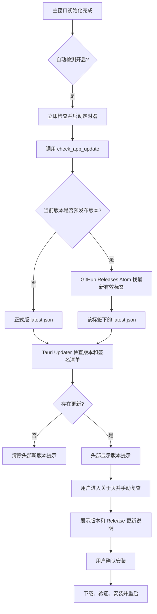

# Lumo-Hub 更新检测逻辑

本文根据当前代码说明 Lumo-Hub 如何发现、展示和安装新版本，供开发维护和故障排查使用。代码或发布方式变更时应同步更新本文。

## 流程概览

## 自动检测设置

自动检测配置保存在客户端本地设置中：

| 设置键                       | 默认值  | 可选值                     | 作用                                                                     |
| ---------------------------- | ------- | -------------------------- | ------------------------------------------------------------------------ |
| `lumo-auto-update-check`     | 开启    | `true` / `false`           | 开启时主窗口就绪后立即检查，并周期检查；关闭时停止定时检查并隐藏头部提示 |
| `lumo-update-check-interval` | 10 分钟 | 10、30、60、360、1440 分钟 | 控制定时检查间隔                                                         |

缺失或不支持的间隔会回退为 10 分钟。用户更改间隔时会重设定时器；从关闭切换到开启时会立即检查。程序退出后定时器停止，因此此功能不是后台服务，应用不运行时不会检查。

自动检查期间若请求失败，不弹出错误、不清除上次已发现的版本提示，也不阻断主窗口。通过 generation 标记丢弃已失效设置周期中的迟到结果，并避免同时发起多个检查。

实现位置：更新设置解析（`src/lib/update-preferences.ts`）、主窗口后台检查（`src/App.vue`）、应用设置界面（`src/views/SettingsPage.vue`）。

## 更新源与版本选择

Rust 命令 `check_app_update` 根据当前应用的 SemVer 预发布字段选择更新源：

- **正式版本**读取 `https://github.com/yeyongzhi/Lumo-Hub/releases/latest/download/latest.json`。
- **预发布版本**先读取仓库 `releases.atom`，按 GitHub 返回顺序查找第一个属于 `yeyongzhi/Lumo-Hub` 且标签可解析为 SemVer 的 Release，再从该标签下载 `latest.json`。例如 `0.0.1-beta.13` 按 beta 预发布渠道检查。

Atom 只用于解析预发布清单地址；实际版本比较和更新对象由 Tauri Updater 完成。后端设置 20 秒 Atom 请求超时、30 秒 updater 请求超时；updater 完整检查最多尝试三次。更新器根据应用配置的公钥验证更新清单中的签名，成功后才向前端返回可用更新对象；无更新时返回 `null`。

实现位置：Rust 更新命令与渠道选择（`src-tauri/src/updates.rs`）、Tauri updater 公钥与默认稳定源（`src-tauri/tauri.conf.json`）。

## 新版本提示与关于页面

后台发现更新后，主窗口只保留版本号，并在顶部显示“发现新版本”按钮；按钮 tooltip 为“新版本：版本号”。后台请求失败静默处理。后台检查返回无更新时会清除版本提示。

点击提示会导航到“设置 → 关于”，并再次执行一次完整检查。再次检查用于获得后续安装所需的 updater 更新对象。帮助菜单里的“检查更新”也进入关于页面并发起相同检查。

关于页面会显示当前版本、发现的新版本和 Release 更新说明。更新说明优先调用 `get_release_notes` 从 GitHub Release 获取；失败时保留 `latest.json` 内的说明，并显示说明读取失败状态。无更新时显示当前已是最新版本；检查失败时显示错误并允许用户重试。

实现位置：主窗口导航与提示（`src/App.vue`）、关于页检查与状态展示（`src/views/AboutPage.vue`）、设置页请求路由（`src/views/SettingsPage.vue`）、Release 更新说明读取（`src-tauri/src/updates.rs`）。

## 确认、下载与安装

用户在关于页面选择安装后，先通过确认框确认目标版本。确认后，前端调用 Tauri Updater 的 `downloadAndInstall`：

1. 根据下载事件展示实际进度；服务未提供总长度时不显示伪造百分比。
2. Tauri updater 使用配置的公钥验证更新产物签名。
3. 下载和安装完成后调用 Tauri `relaunch` 重启应用。
4. 下载、校验或安装失败时显示错误，并结束安装中状态；不会显示安装成功。

用户数据由应用的数据目录管理，更新器安装的是程序产物。安装确认文字说明用户数据会保留。

## 发布产物关系

Windows x64 发布需要以下三个文件：

| 文件                               | 用途                                                                      |
| ---------------------------------- | ------------------------------------------------------------------------- |
| `Lumo-Hub_<version>_x64-setup.exe` | NSIS 安装包，也是 updater 下载和安装的产物                                |
| 同名 `.exe.sig`                    | 使用 updater 私钥生成的签名；对应公钥配置在 Tauri updater 插件中          |
| `latest.json`                      | 提供版本、更新说明、发布时间、平台下载地址及签名，放在对应 Release 标签下 |

构建配置启用 `createUpdaterArtifacts`。`scripts/prepare-release.ps1` 从 `tauri.conf.json` 读取应用版本，读取 NSIS 安装包和签名文件，并生成 Windows `windows-x86_64` 清单。发布 beta 时将清单、安装包和签名一起上传到与清单 URL 相同的 GitHub Release 标签。

预发布清单 URL 的标签选择由 Rust Atom 解析逻辑提供；正式版清单 URL 使用 Tauri 配置的稳定 latest 地址。发布时需检查清单版本、标签、文件名、平台键、下载地址和签名相互匹配，并确认目标 Release 已发布且不是草稿。

实现位置：Tauri 打包与 updater 配置（`src-tauri/tauri.conf.json`）、Release 清单生成脚本（`scripts/prepare-release.ps1`）、Rust 预发布清单解析（`src-tauri/src/updates.rs`）。

## 故障排查

| 表现                   | 检查方向                                                                                   |
| ---------------------- | ------------------------------------------------------------------------------------------ |
| 自动检查不运行         | 确认客户端设置 `lumo-auto-update-check` 未关闭、主窗口已初始化；自动检查仅在应用运行时执行 |
| 头部没有提示           | 确认当前版本渠道所用 Release 清单存在且版本高于当前版本；后台错误不会主动显示通知          |
| 关于页面提示清单未找到 | 检查稳定 latest 清单，或 beta Atom 中是否有有效 SemVer 标签及对应 `latest.json`            |
| 检查更新失败           | 检查 GitHub、Atom、Release 下载域名的网络连通性，以及更新清单 JSON 和签名是否有效          |
| 版本可见但更新说明为空 | 检查对应 Release 的正文；Release API 获取失败时页面回退到清单中的 `notes`                  |
| 下载或签名验证失败     | 核对安装包与 `.sig` 是否来自同一次构建、发布清单是否使用匹配公钥的签名                     |
| 安装后未更新           | 检查目标平台资产和 `windows-x86_64` 映射、Tauri 安装器执行结果及重启行为                   |

## 关键边界

- 自动检测只负责发现和提示，不会自动下载、安装或重启。
- 关闭自动检测只影响定时后台检查；用户仍可从关于页面手动检查。
- 自动后台错误静默；完整错误反馈在关于页面手动检查时展示。
- 预发布安装渠道依赖 GitHub Atom 返回顺序和标签 SemVer 解析结果；发布流程应避免把非目标渠道的版本排到预期 beta 之前。
- 当前清单生成脚本只列出 Windows x64；若增加平台或架构，需要扩展构建、清单和 Release 资产，并验证对应安装流程。
